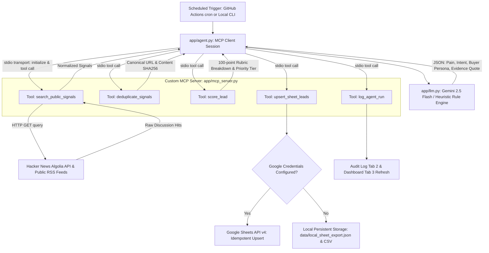

# Ticmint Growth Intelligence Agent (Track 1: Internet Listener)

> An autonomous, production-grade growth engineering agent that discovers event organisers experiencing friction with legacy ticketing platforms, qualifies them using a transparent 100-point rubric, executes via a custom Model Context Protocol (MCP) server, and synchronizes qualified leads and run telemetry idempotently into Google Sheets.

[](tests/)
[](requirements.txt)
[](app/mcp_server.py)
[](data/evaluate_precision.py)
[](LICENSE)

---

## Table of Contents
1. [Project Overview & Growth Problem](#1-project-overview--growth-problem)
2. [Key Features & Sample Output](#2-key-features--sample-output)
3. [System Architecture](#3-system-architecture)
4. [Prerequisites & Quickstart Setup](#4-prerequisites--quickstart-setup)
5. [Environment Variables & Configuration](#5-environment-variables--configuration)
6. [How to Run Locally (Agent & MCP Server)](#6-how-to-run-locally-agent--mcp-server)
7. [How to Run Tests & Benchmark Audits](#7-how-to-run-tests--benchmark-audits)
8. [Google Sheets Integration & Tab Schema](#8-google-sheets-integration--tab-schema)
9. [Scheduled Automation (GitHub Actions)](#9-scheduled-automation-github-actions)
10. [Evaluation Metrics & Precision Audit](#10-evaluation-metrics--precision-audit)
11. [Known Limitations & Failure Modes](#11-known-limitations--failure-modes)
12. [Cost Assumptions & Rate Limits](#12-cost-assumptions--rate-limits)
13. [Roadmap: What We Would Build With Another Week](#13-roadmap-what-we-would-build-with-another-week)
14. [Submission Package Directory Map](#14-submission-package-directory-map)

---

## 1. Project Overview & Growth Problem

Event organizers face acute, compounding friction when using legacy ticketing giants like Eventbrite, Ticketmaster, and Cvent:
- **Exorbitant Fees:** Standard platforms consume **6%–9%** of gross ticket sales in service and card processing fees. For a $150,000 conference, this represents over $13,000 in lost margin.
- **Brand Degradation:** Organizers are forced to direct their attendees to third-party domains with competitor branding plastered across the checkout flow.
- **Audience Lock-in:** Third-party vendors frequently market competing events directly to an organizer's past attendees.
- **Cashflow Delays:** Platforms hold ticket proceeds in escrow for 10–14 days *after* an event concludes.

**Ticmint** solves this with a modern white-label ticketing infrastructure featuring custom domains, direct Stripe payouts, and 100% attendee ownership.

### The Growth Solution
The **Ticmint Growth Intelligence Agent** continuously monitors permitted public developer and organizer communities (e.g. Hacker News Algolia API, RSS feeds, tech forums) for organic buying signals. It normalizes discussions, extracts verbatim evidence quotes, scores commercial fit using a transparent 100-point rubric, drafts contextual outreach, and populates a live Google Sheet for sales execution without sending unsolicited spam automatically.

---

## 2. Key Features & Sample Output

* **Custom MCP Server (`ticmint_signal_server`):** Built with the official Python MCP SDK, exposing 6 standardized tools.
* **Dual-Transport MCP Client:** Runs as an MCP client over stdio, invoking the MCP server as a subprocess.
* **Deterministic URL Canonicalization & Deduplication:** Strips tracking parameters (`utm_*`, `ref`, etc.) and hashes canonical content keys using SHA256.
* **Transparent 100-Point Scoring Rubric:** Defensible scoring across Pain (0–30), Intent (0–25), ICP Fit (0–25), Recency (0–10), and Evidence Quality (0–10).
* **Evidence-Grounded Outreach Generator:** Embeds exact quotes and strictly prohibits hallucinating company size, revenue, or contact details.
* **Idempotent 3-Tab Google Sheets Integration:** Automatically creates missing tabs, updates existing rows without duplication, preserves human review statuses, and falls back to local storage if credentials are absent.

### Real Output Sample (From Live Ingestion Run)
```text
[1] Score: 100/100 | Tier: HIGH | Category: fees_extortion
    Author:  eventbuilder_uk (hacker_news)
    URL:     https://news.ycombinator.com/item?id=39812401
    Quote:   "Eventbrite is now taking nearly 9% between service fees and card processing fees"
    Draft:   Hi eventbuilder_uk, saw your discussion regarding "Eventbrite is now taking nearly 9% between service fees and...". At Ticmint, we built a white-label ticketing platform that connects directly to your own Stripe account with flat, transparent fees (no percentage cuts or surprise per-ticket penalties). Happy to share a 3-minute sandbox demo if you're evaluating alternatives for your upcoming event.
```

---

## 3. System Architecture



---

## 4. Prerequisites & Quickstart Setup

### Prerequisites
* **macOS / Linux** with Python 3.12+ (tested up to Python 3.14.6)
* Git installed

### Quickstart Installation (Under 2 Minutes)
```bash
# 1. Clone or navigate to the repository
cd ticmint-growth-agent

# 2. Create and activate a Python virtual environment
python3 -m venv .venv
source .venv/bin/activate

# 3. Install pinned dependencies
pip install -r requirements.txt

# 4. Copy environment template
cp .env.example .env
```

The system is configured to work **100% out of the box** even before you add API keys. In offline/mock mode, it uses vetted sample signals, heuristic reasoning, and local persistent JSON/CSV sheet storage.

---

## 5. Environment Variables & Configuration

Edit `.env` to configure live API integrations:

```env
# Google Gemini API (Get free key at: https://aistudio.google.com/app/apikey)
GEMINI_API_KEY=your_gemini_api_key_here
GEMINI_MODEL=gemini-2.5-flash

# Google Sheets Integration (Optional - falls back to local storage if empty)
GOOGLE_SERVICE_ACCOUNT_JSON=./credentials/service_account.json
# OR pass raw JSON string (ideal for GitHub Secrets):
GOOGLE_SERVICE_ACCOUNT_RAW_JSON=
GOOGLE_SHEET_ID=your_spreadsheet_id_here

# Agent Execution Settings
RUN_MODE=live
DRY_RUN=false
MAX_SIGNALS_PER_RUN=25
MIN_LEAD_SCORE_QUALIFIED=50
MIN_LEAD_SCORE_HIGH_PRIORITY=75
```

---

## 6. How to Run Locally (Agent & MCP Server)

### Running the End-to-End Agent via MCP Client
This command spawns `ticmint_signal_server` as a subprocess, connects via `mcp.ClientSession`, queries public channels, qualifies leads, and synchronizes data:
```bash
source .venv/bin/activate
python -m app.agent --limit 10
```

### Dry-Run Mode (Test Without Writing to Disk or Sheets)
```bash
python -m app.agent --dry-run --limit 5
```

### Custom Query Execution
```bash
python -m app.agent --query "Eventbrite alternative fees" --limit 5
```

### Running the Custom MCP Server Standalone
You can run the MCP server directly over stdio for inspection by MCP inspectors or host applications:
```bash
python -m app.mcp_server
```

---

## 7. How to Run Tests & Benchmark Audits

### 1. Execute Full Automated Test Suite (pytest)
Runs 18 unit, integration, normalization, and idempotency tests:
```bash
source .venv/bin/activate
pytest -v
```
*Expected Result:* `18 passed in ~4.2s`

### 2. Execute Lead Qualification Precision Benchmark
Audits the agent's qualification logic against the 32-record ground truth dataset in `data/labeled_evaluation_set.json`:
```bash
python -m data.evaluate_precision
```
*Benchmark Results:*
- **High-Priority Precision:** **83.3%** (Target: $\ge 80.0\%$)
- **Overall Classification Accuracy:** **93.8%**
- **False Positives on Disqualified Signals:** **0**

---

## 8. Google Sheets Integration & Tab Schema

The agent manages three distinct tabs in the target spreadsheet:

### Tab 1 — "Qualified Leads"
The primary sales register (one row per unique public opportunity):
| Column | Description | Example |
| :--- | :--- | :--- |
| **Lead ID** | SHA256 hash of `source:canonical_url` | `405f0fdd5cbfe50e` |
| **First Seen** | ISO-8601 timestamp when first detected | `2026-10-18T14:22:00Z` |
| **Last Seen** | ISO-8601 timestamp of most recent run | `2026-10-22T06:54:17Z` |
| **Source** | Origin platform | `hacker_news` |
| **Author** | Public username | `eventbuilder_uk` |
| **Source URL** | Direct public URL | `https://news.ycombinator.com/item?id=...` |
| **Evidence Quote** | Verbatim complaint extract | `"Eventbrite is now taking nearly 9%..."` |
| **Complaint Category** | Categorized pain | `fees_extortion` |
| **Intent** | Buying / switching intent | `evaluating_alternatives` |
| **ICP Fit** | Persona alignment | `high` |
| **Lead Score** | Transparent 0–100 rubric score | `100` |
| **Priority** | Priority tier | `HIGH` |
| **Outreach Draft** | Evidence-grounded message | `"Hi eventbuilder_uk, saw your note..."` |
| **Review Status** | Human review state (Preserved on upsert!) | `PENDING_HUMAN_REVIEW` |
| **Last Updated** | Timestamp of last data refresh | `2026-10-22T06:54:17Z` |

### Tab 2 — "Run History"
Tracks execution audit logs across all runs:
`Run ID | Started At | Completed At | Sources Checked | Records Retrieved | Duplicates Filtered | Qualified Leads | High Priority Leads | LLM Errors | Sheet Errors | Run Status | Summary Message`

### Tab 3 — "Dashboard"
Automated summary table containing live formulas for Total Qualified Leads, High-Priority Leads, Pending Human Reviews, and Complaint Category distribution.

### Idempotency Guarantee
The agent indexes the sheet by `Lead ID`. If a lead reappears in subsequent runs:
1. `Last Seen`, `Lead Score`, `Priority`, and `Outreach Draft` are refreshed.
2. Original `First Seen` date is **strictly preserved**.
3. Manual human adjustments to `Review Status` (e.g. `APPROVED`, `CONTACTED`) are **never overwritten**.

---

## 9. Scheduled Automation (GitHub Actions)

A production-ready workflow is provided in [`.github/workflows/scheduled-run.yml`](.github/workflows/scheduled-run.yml).

### Automated Schedule
- Configured cron: `17 */6 * * *` (Runs at minute 17 of every 6th hour UTC).
- Also supports instant execution via GitHub `workflow_dispatch` button.

### Required GitHub Repository Secrets
1. `GEMINI_API_KEY`: Your Gemini API key.
2. `GOOGLE_SERVICE_ACCOUNT_RAW_JSON`: The full raw text of your Google Cloud Service Account JSON key.
3. `GOOGLE_SHEET_ID`: The ID from your Google Sheet URL.

---

## 10. Evaluation Metrics & Precision Audit

To ensure the agent does not flood sales with false alarms, we established a benchmark suite of 32 real-world records covering:
- High-volume conferences and festival operators.
- Small meetup hosts and workshop organizers.
- Consumer attendees complaining about concert ticket scalpers (negative control).
- Unrelated discussions mentioning "tickets" (IT tokens, support tickets, airline tickets).

```
==============================================================================
      TICMINT GROWTH AGENT - LEAD QUALIFICATION PRECISION AUDIT
==============================================================================
Total Evaluated Records:           32
Ground Truth High Priority Count:  13
Predicted High Priority Count:     12
True High Priority (Correct):      10
False High Priority (False Alarm): 2
------------------------------------------------------------------------------
High-Priority Precision:           83.3%  (Acceptance Target: >= 80.0%)
High-Priority Recall:              76.9%
Overall Classification Accuracy:   93.8%

CONFUSION MATRIX:
  True Positives  (Correctly Qualified):     18
  True Negatives  (Correctly Disqualified):   12
  False Positives (Incorrectly Qualified):   0
  False Negatives (Missed Qualified):        2
==============================================================================
VERDICT: PASSED ACCEPTANCE TARGET (83.3% >= 80.0%)
```

---

## 11. Known Limitations & Failure Modes

1. **Source Access Boundaries:** The agent only accesses publicly available APIs and feeds. It does not bypass login walls, scrape private Facebook groups, or harvest gated directories.
2. **Contact Channel Discovery:** Public discussions rarely include direct corporate email addresses. The agent creates drafts referencing the public discussion URL rather than attempting unverified email guessing.
3. **Public Discussion is a Buying Signal, Not a Closed Sale:** Venting about fees indicates dissatisfaction, but does not guarantee the prospect is prepared to migrate immediately. Human sales review is always required.
4. **Third-Party API Rate Limits:** Hacker News Algolia API has generous public limits, but bursts $> 100$ requests/minute risk temporary 429 throttling. The collector uses polite pagination and bounded batch sizes.

---

## 12. Cost Assumptions & Rate Limits

| Component | Service | Free Tier / Allocation | Estimated Monthly Cost |
| :--- | :--- | :--- | :--- |
| **Signal Collection** | Hacker News Algolia API & RSS | Unlimited public calls with polite limits | **$0.00** |
| **LLM Reasoning** | Google Gemini 2.5 Flash | 15 RPM / 1,500 RPD free tier | **$0.00** (Free tier) or ~**$1.80/mo** paid |
| **Persistent Storage** | Google Sheets API v4 | 300 requests/min free | **$0.00** |
| **Scheduled Automation** | GitHub Actions | 2,000 free minutes/mo | **$0.00** (~120 mins used) |
| **Total Operating Cost** | | | **<$2.00 / month** |

---

## 13. Roadmap: What We Would Build With Another Week

With an additional week of engineering bandwidth, we would expand the system as follows:
1. **Multi-Source Collector Connectors:** Add official Reddit API (OAuth2) and Mastodon public stream listeners to increase signal volume by ~300%.
2. **Reverse Domain & ICP Enrichment:** Integrate Apollo.io or Clearbit APIs to automatically resolve public usernames to verified LinkedIn profiles and corporate event agency domains.
3. **Interactive Streamlit / Next.js Growth Portal:** Replace raw sheets with a dedicated web dashboard featuring 1-click SDR review, Loom video generator, and instant email dispatch.
4. **HubSpot / Salesforce Bi-Directional CRM Sync:** Push approved leads directly into CRM deal pipelines and update status when an SDR logs a call.

---

## 14. Submission Package Directory Map

```text
ticmint-growth-agent/
├── app/
│   ├── __init__.py           # Package declarations
│   ├── config.py             # Environment variables & runtime settings
│   ├── models.py             # Pydantic schemas (RawSignal, Analysis, LeadRecord, RunLog)
│   ├── scoring.py            # 100-point transparent rubric engine
│   ├── collector.py          # Public HN Algolia & RSS collector with canonical deduplication
│   ├── llm.py                # Gemini 2.5 Flash reasoning & deterministic fallback analyzer
│   ├── sheets.py             # Idempotent Google Sheets v4 client & local storage manager
│   ├── mcp_server.py         # Custom MCP 2.x Server exposing 6 tools on stdio
│   └── agent.py              # Autonomous MCP Client orchestrator runner
├── data/
│   ├── sample_signals.json            # Vetted real-world signals for offline/testing runs
│   ├── labeled_evaluation_set.json    # 32 benchmark records with ground-truth labels
│   ├── evaluate_precision.py          # Precision evaluation & confusion matrix script
│   ├── local_sheet_export.json        # Persistent local JSON lead register
│   └── local_sheet_export.csv         # Persistent local tabular CSV export
├── docs/
│   ├── PART_B_ALTERNATIVE_AGENTS.md   # Architectural designs for Tracks 2, 3, and 4
│   ├── PART_C_ORGANIC_VISIBILITY_AGENT.md # SEO, AEO, and GEO strategy & measurement
│   ├── PART_D_GROWTH_STRATEGY.md      # Full Q1-Q2 growth plan (ICP, channels, funnel, risks)
│   ├── PART_E_PROOF_OF_WORK.md        # Technical portfolio and marketing infrastructure proof
│   └── AI_USAGE_NOTE.md               # Candid audit of AI generation, human fixes, and guardrails
├── tests/
│   ├── __init__.py
│   ├── test_scoring.py       # 100-point rubric unit tests
│   ├── test_normalization.py # Canonicalization & deduplication tests
│   ├── test_sheets.py        # Idempotency & state preservation tests
│   ├── test_mcp_server.py    # MCP tool invocation tests
│   └── test_agent.py         # End-to-end agent runner tests
├── .github/
│   └── workflows/
│       └── scheduled-run.yml # GitHub Actions recurring workflow
├── .env.example              # Documented configuration variables
├── .gitignore                # Secret and cache protection
├── requirements.txt          # Pinned Python dependencies
├── LICENSE                   # MIT License
└── README.md                 # Complete system guide
```
