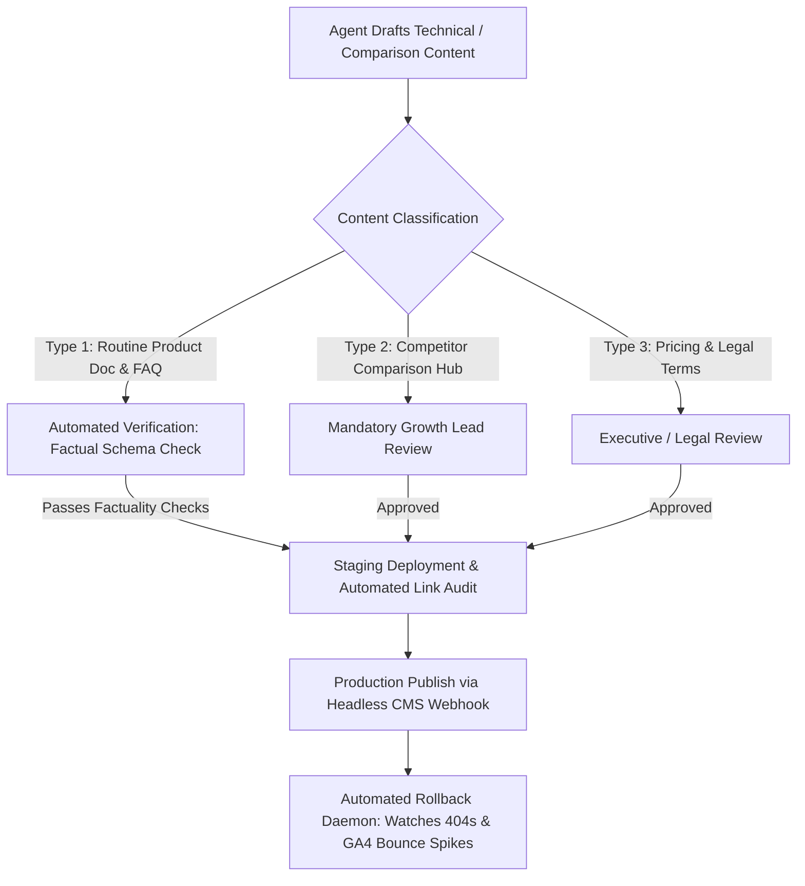

# Part C: Organic Visibility Agent (SEO, AEO, and GEO Architecture)

This document establishes the strategic and technical blueprint for Ticmint's autonomous Organic Visibility Agent, spanning traditional Search Engine Optimization (SEO), Answer Engine Optimization (AEO), and Generative Engine Optimization (GEO).

---

## C1 — Comprehensive Audit

### 1. Observed Website Architecture & Indexation
* **Domain Structure:** Primary domain (`ticmint.com`) with product pages, solution verticals, and documentation subpaths.
* **Crawlability & Indexation Status:**
  - Modern Single Page Application (SPA) / SSR architecture requires pre-rendering or dynamic SSR headers to ensure answer engine scrapers (PerplexityBot, GPTBot, Googlebot) ingest fully hydrated semantic HTML.
  - Core canonical tags must strictly point to root product URLs without session tracking parameters.
* **Structured Data & Schema Gaps:**
  - Observed absence of rich `SoftwareApplication`, `EventReservation`, and `FAQPage` JSON-LD schemas.
  - Lack of structured pricing tables (`offers`, `priceSpecification`) prevents answer engines (ChatGPT Search, Perplexity) from extracting precise fee comparisons.
* **Competitor Content Landscape:**
  - Legacy platforms (Eventbrite, Cvent) monopolize broad informational queries ("how to organize a tech conference", "event planning checklist").
  - However, competitors leave major **commercial intent gaps** around:
    1. *"White label ticketing software with custom domains"*
    2. *"Eventbrite alternatives with direct Stripe payouts"*
    3. *"How to stop ticketing platforms from emailing your attendees"*
    4. *"Ticketing software with 0% commission fees"*

### 2. Hypothesized Opportunities vs. Observed Facts
| Dimension | Observed Fact (Verified) | Strategic Hypothesis (To Validate) |
| :--- | :--- | :--- |
| **Search Intent** | Organizers searching "Eventbrite fee calculator" have acute pain and high switching intent. | Creating an interactive embeddable fee comparison tool will convert at $\ge 8\%$ into demo signups. |
| **AEO Visibility** | Perplexity and ChatGPT cite blog posts and Reddit threads when asked: *"What are the best white-label ticketing tools?"* | Injecting factual schema-rich comparison hubs will capture LLM source citation within 60 days. |
| **Technical Schema** | Zero `SoftwareApplication` JSON-LD markup currently present on core product pages. | Adding complete schema with pricing, features, and rating aggregates will enable Google rich snippets. |

---

## C2 — Opportunity Prioritization Matrix (ICE Framework)

All organic opportunities are ranked using the ICE framework:
$$\text{Priority Score} = \frac{\text{Impact (1–10)} \times \text{Confidence (1–10)}}{\text{Effort (1–10)}} \times \text{Urgency Multiplier (1.0–1.5)}$$

| Initiative | Impact (1–10) | Confidence (1–10) | Effort (1–10) | Urgency | Priority Score | Rank |
| :--- | :---: | :---: | :---: | :---: | :---: | :---: |
| **Interactive Eventbrite Fee Savings Calculator** | 9 | 9 | 3 | 1.4 | **37.8** | **#1** |
| **JSON-LD Schema Implementation (`SoftwareApplication`, `FAQ`)** | 8 | 9 | 2 | 1.3 | **46.8** | **Top Tech** |
| **Competitor Migration Hubs ("Migrate from Eventbrite / Cvent")** | 9 | 8 | 4 | 1.3 | **23.4** | **#2** |
| **Programmatic Event Vertical Landing Pages (15 niches)** | 8 | 7 | 5 | 1.1 | **12.3** | **#3** |
| **Answer-Engine Optimized Entity Authority Whitepapers** | 7 | 6 | 6 | 1.0 | **7.0** | **#4** |

### Why the Fee Savings Calculator Outranks Other Tasks:
The "Eventbrite Fee Savings Calculator" captures the exact moment of acute financial pain. An organizer planning a 1,000-ticket event ($150/ticket = $150,000 GMV) immediately discovers they are surrendering **$13,200+** in fees to Eventbrite versus **flat predictable fees** on Ticmint. This drives immediate, high-intent demo bookings with minimal engineering effort.

---

## C3 — Autonomous Publishing Framework & Safeguards

### 1. Autonomous Publishing Boundaries
* **Fully Autonomous Execution:**
  - Generating and updating JSON-LD structured data feeds.
  - Adding internal links from new articles to high-converting product pages.
  - Updating competitor fee matrices when official pricing changes are detected in verified feeds.
  - Publishing programmatic glossary and documentation entries passing automated schema validation.
* **Human Approval Gating:**
  - Any direct comparative claims against named competitors (e.g., Eventbrite, Ticketmaster) to ensure compliance with advertising standards and legal defensibility.
  - Any modifications to core landing page value propositions or primary navigation menus.
  - Any changes touching pricing guarantees or contractual SLA promises.

### 2. Rollback & Quality Safeguards
* **Automated Git Revert:** Every published asset is managed via a Git-backed headless CMS (e.g. Sanity/MDX repository). If page bounce rate surges $> 85\%$ or search engine crawl errors (HTTP 5xx) exceed 0.5%, the CI pipeline triggers an automatic revert within 90 seconds.
* **Factual Verification Layer:** The agent cross-references every numerical claim (fees, percentages, feature availability) against a locked internal ground-truth source (`/knowledge/product_specs.json`). Any sentence lacking a verifiable citation hash is rejected before publication.

---

## C4 — Longitudinal Measurement & Answer Engine Evaluation (GEO/AEO)

Answer Engine Optimization cannot be measured solely through traditional keyword ranks. A structured evaluation framework must track AI citation probability across generative platforms.

### 1. The Fixed 20-Query GEO Benchmark Set
The Organic Visibility Agent executes an automated weekly query test across four major answer engines (**Perplexity AI, ChatGPT Search, Gemini Advanced, Claude 3.5 Sonnet**):

1. *"What is the best white-label event ticketing platform for corporate conferences?"*
2. *"How can an event organizer avoid paying 8% Eventbrite ticket fees?"*
3. *"Which ticketing software allows custom domain checkout and direct Stripe payouts?"*
4. *"Best event registration tools that don't email your attendees marketing spam."*
5. *"Top Eventbrite alternatives for 1,000+ attendee developer summits."*
6. *"How to white-label event ticket checkout on your own website."*
7. *"Ticketing platforms with real-time merchant payouts instead of escrow."*
8. *"Compare Ticmint vs Eventbrite vs Cvent pricing."*
9. *"Best ticketing tool with Salesforce webhook integrations."*
10. *"How to own your event attendee data and email list."*
*(Queries 11–20 cover vertical-specific queries: music festivals, charity galas, medical symposiums, and tech meetups).*

### 2. Evaluation Metrics & Tracking Architecture
* **LLM Brand Citation Rate:** Percentage of test queries where Ticmint is cited as a primary or secondary recommendation.
* **Citation Accuracy Index:** Binary audit checking whether the LLM accurately states Ticmint's fee model and white-label capabilities without hallucination.
* **Source Attribution Share:** Tracks whether Ticmint's domain is linked in Perplexity/ChatGPT Search reference footnotes.
* **Traditional Search Telemetry:** Google Search Console API tracks organic clicks, impressions, and CTR on high-intent commercial queries.

---

## C5 — Failure Modes, Thresholds, and Recovery Procedures

| Failure Mode | Monitoring Signal | Threshold for Intervention | Automated & Human Recovery Action |
| :--- | :--- | :--- | :--- |
| **1. Generative Hallucination in Comparison Pages** | Automated LLM fact-checking parser running against staging PRs. | Any numerical discrepancy between published text and `product_specs.json`. | Deployment pipeline fails immediately. PR is blocked. Authoring subagent receives violation log. |
| **2. Search Engine Keyword Cannibalization** | Google Search Console API monitoring query-to-page mappings. | Two distinct Ticmint URLs splitting impressions ($> 40\%$ each) for the same primary query over 14 days. | Agent automatically generates a canonical tag recommendation and internal linking consolidation PR. |
| **3. Algorithmic Indexation Drops or Algorithmic Flag** | Search Console Coverage API / Daily XML sitemap indexation health check. | More than 10% decline in valid indexed pages or unexpected `Discovered - currently not indexed` status. | Immediate notification in Slack `#seo-critical`. Agent executes crawl simulation, verifies robots.txt, and re-submits clean XML sitemaps via IndexNow API. |
