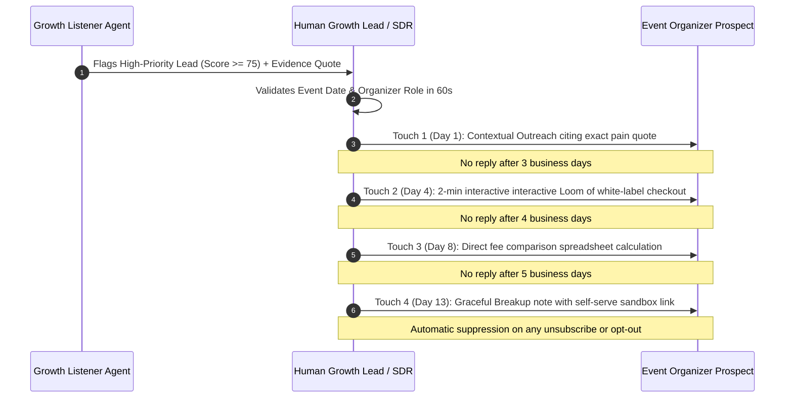

# Part D: Ticmint Growth Strategy (Q1–Q2 Execution Plan)

---

## D1 — Ideal Customer Profile (ICP) & Buying Personas

### 1. Primary ICP: Independent Event Production Agencies & Conference Operators
* **Profile:** Agencies and independent media/tech companies organizing 3–15 ticketed events annually (summit size: 400–2,500 attendees per event).
* **Key Decision Makers:** Head of Events, Agency Managing Director, VP of Event Operations.
* **Acute Pain Points:**
  - Surrendering 6–9% of top-line ticket revenue to legacy ticketing platforms ($30k–$80k+ annual fee leakage).
  - Client branding degradation: Corporate sponsors and enterprise clients demand zero third-party branding (no "Powered by Eventbrite" watermarks).
  - Hijacked audience data: Platforms marketing competitor events to their attendees.
* **Buying Triggers & Urgency:**
  - Annual ticketing contract renewal with Cvent/Eventbrite.
  - A major event where third-party checkout crashed or held ticket payouts in escrow.
  - Onboarding a new tier-1 corporate client demanding custom domain registration.

### 2. Secondary ICP: High-Cadence Community & Workshop Operators
* **Profile:** Professional education academies, regional developer conferences, and recurring weekend workshop organizers (20–50 attendees/session, 2–4 cohorts/month).
* **Key Decision Makers:** Community Founder, Lead Instructor, Operations Lead.
* **Acute Pain Points:** Administrative chaos balancing Stripe links, Google Forms, and manual attendee check-in; fee fatigue on high-volume low-cost tickets.

---

## D2 — Strategic Acquisition Channels (Next Two Quarters)

| Channel Priority | Strategic Rationale | 90-Day Success Criteria |
| :--- | :--- | :--- |
| **Channel 1: Algorithmic Intent Outbound (The Part A Agent)** | Programmatically identifies organizers publicly venting about fee hikes, payout holds, or branding constraints across Hacker News, Reddit, and community forums. Reaches prospects at the exact moment of dissatisfaction. | **$\ge 45$ qualified sales conversations booked**; $\ge \$350\text{k}$ in pipeline Gross Merchandise Value (GMV); CAC $< \$220$. |
| **Channel 2: High-Intent SEO/GEO Migration Hubs** | Captures organizers searching for "Eventbrite fee calculator", "White label ticketing platform", and "Eventbrite alternatives" via interactive savings tools and answer engine citations. | **Top-3 ranking for 8 high-intent terms**; 2,500 monthly unique calculator sessions; $\ge 60$ self-serve / demo inquiries. |
| **Channel 3: Agency Co-Marketing & Partner Referral Program** | Event production agencies manage ticketing across dozens of enterprise clients. Equipping them with a dedicated white-label multi-tenant agency console turns agencies into distribution partners. | **8 signed agency design partners** managing $\ge \$1.2\text{M}$ aggregate annual ticketing volume. |

---

## D3 — Outbound Engine: Rules, Cadence, and Guardrails



### 1. Qualification & Personalization Rules
* **Rule of Evidence:** No outreach may be generated or sent without a verbatim excerpt from the prospect citing a verified ticketing problem.
* **No Speculative Fluff:** Cold emails must never invent attendee counts, revenue, or event dates. If unverified, address the general technical requirement.
* **Hard Stop Conditions:**
  - Immediate sequence termination if prospect responds with any negative sentiment or opt-out.
  - Automatic suppression if prospect's next event has already concluded (stale timing).
  - Maximum 4 touchpoints over 14 calendar days; never re-contact an unresponsive lead within 180 days.

---

## D4 — Full-Funnel Architecture & Conversion Gates

```
[ TOFU: Top of Funnel ]
• Public discussion listener hits (Part A)
• Interactive Fee Savings Calculator & GEO Answer Engine Citations
• Organic search landing pages ("White label event ticketing")
         │
         ▼ [GATE 1: Minimum Qualification Score >= 50 + Organizer Persona]
[ MOFU: Middle of Funnel ]
• Human-approved evidence-grounded outreach sequence
• Self-serve sandbox demo (Test custom domain & Stripe payout connect)
• 1-on-1 Strategy & Architecture Call with Growth Lead
         │
         ▼ [GATE 2: Event Date Set + Expected GMV > $10,000]
[ BOFU: Bottom of Funnel ]
• Pilot event setup on custom subdomain (e.g. tickets.agencyconference.com)
• Stripe Connect onboarding (direct organizer merchant payout verification)
• Production ticket launch & live attendee check-in app deployment
```

* **Disqualification Gates:**
  - Consumer ticket buyers or fans complaining about concert ticket scalpers.
  - Organizers of 100% free non-ticketed events with zero expansion potential.
  - Users demanding ticketing escrow or high-risk unregistered merchant categories.

---

## D5 — Growth Metrics & Telemetry

### 1. The North Star Metric
$$\mathbf{Monthly\ Processed\ GMV\ on\ White-Label\ Checkouts\ (\text{Gross Merchandise Value})}$$
* **Why this metric?** Gross Merchandise Value processed through Ticmint's white-label checkout directly reflects organizer adoption, attendee transaction trust, and platform health. Because Ticmint charges a transparent processing fee, revenue scales linearly with GMV without gouging organizers.

### 2. Leading Indicators (Weekly Cadence)
* **High-Priority Pain Signals Ingested:** Count of verified discussions scoring $\ge 75$ per week (Target: $\ge 25/\text{week}$).
* **Personalized Outreach Reply Rate:** Percentage of evidence-grounded emails receiving a positive organizer response (Target: $\ge 18\%$).
* **Interactive Calculator Engagements:** Organizers completing a fee comparison calculation (Target: $\ge 500/\text{month}$).
* **Sandbox Event Launches:** Organizers configuring custom branding and Stripe connect in sandbox mode (Target: $\ge 30/\text{month}$).

### 3. Lagging Indicators (Monthly / Quarterly Cadence)
* **Active Transacting Organizers (ATO):** Organizers selling $\ge 50$ tickets in a 30-day window.
* **Net Revenue Retention (NRR):** Percentage of GMV retained from recurring annual conference organizers (Target: $\ge 125\%$).
* **Blended Customer Acquisition Cost (CAC):** Total sales & growth spend divided by closed transacting organizers (Target: $< \$450$).

---

## D6 — Key Risks, Assumptions, and Contingencies

| Core Strategic Assumption | Failure Point / Vulnerability | Contingency & Mitigation Plan |
| :--- | :--- | :--- |
| **1. Organizers will switch platforms primarily to escape high fees.** | Organizers value Eventbrite's internal marketplace / organic attendee discovery more than low fees. | **Pivot messaging to Audience Ownership & Direct Stripe Payouts.** Emphasize that Eventbrite's discovery algorithm frequently promotes competing events to their past attendees, causing net attendee erosion. |
| **2. White-label custom domains are a primary requirement for mid-market agencies.** | Agencies lack technical bandwidth or DNS access to configure CNAME records on client domains. | **Provide zero-config Cloudflare SSL onboarding:** Ticmint automatically provisions CNAME/SSL via Cloudflare for SaaS, allowing instant 1-click domain verification. |
| **3. Public social signals provide sufficient volume for predictable sales pipeline.** | API rate limits, deprecations, or shifts in developer forum participation reduce signal velocity. | **Multi-channel source diversification:** Expand listener from Hacker News to Reddit API, Mastodon, Event Industry RSS feeds, and automated G2 review monitoring (Track 2). |
